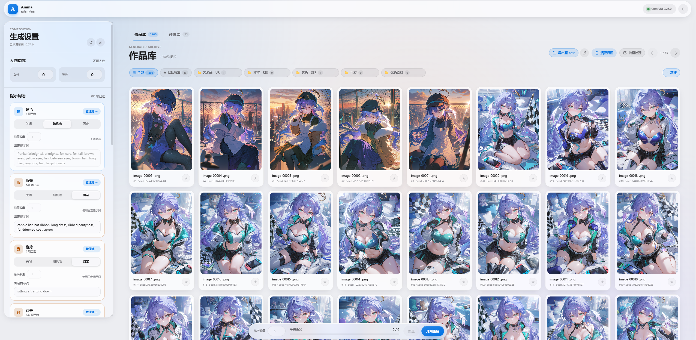

# Anima Random Studio

基于 [ComfyUI](https://github.com/comfyanonymous/ComfyUI) 与 [Anima Tools](https://github.com/nregret/Comfyui-Anima-Tools) 生态深度构建的**本地轻量化随机生图工作台与全生命周期数字资产管理系统**。

核心功能：批量组合tag自动画图；作品和预设资产便捷管理；提供极度清晰明了的工作台界面，便于新手小白快速上手ai画图。

> [!TIP]
> 本项目已进入维护期。仅不定期发布bug修复和小功能优化。随意fork/二次开发。

> ## 上游渊源与项目说明
>
> 本项目是基于 [159159pzy-crypto/comfyui-random-image-generation](https://github.com/159159pzy-crypto/comfyui-random-image-generation) 进行深度扩展与重构的独立版本。感谢原作者为社区提供的核心创意与原型探索。
> 为了满足高频、批量化的生产级出图需求，本项目自 原项目 `v0.4.0` 起进行了全链路重构，重点演化出以下核心能力：
>
> 1. **智能角色换装与「触发词 + 纯容貌」提取**
>    * 支持从角色标签库中精准分离容貌特征（发型、发色、瞳色、五官），自动识别并剥离原设立绘绑定的衣物及服饰配件（如腰带、领结、项圈），同时智能保留角色标志性发饰与头部剪影。
>    * 在保留角色高辨识度的同时，允许自由搭配任意新服装，彻底解决传统换装时的“多层服装拼接与撕裂穿帮”。
> 2. **双库资产管理与批量操作体系**
>    * **独立风格预设库**：重构独立预设卡片面板，支持封面缩略图绑定、参数一键载入与覆盖。
>    * **多级分类与收藏夹**：作品库与预设库均打通分类胶囊栏，支持即时加星收藏与归类管理。
>    * **全功能批量链路**：支持跨页连续多选、批量按序导出至本地、批量物理文件彻底清理与文件锁占用保护。
> 3. **生成链路闭环与底层稳定性加固**
>    * **卡池调度自洽**：彻底修复了角色池纯随机、服装/背景/动作池透传异常、表情池失效以及额外提示词槽位污染背景的问题。
>    * **拓扑与数据流清洗**：优化节点底层连线，根治提示词二次随机漂移与图片元数据残留问题，确保生成的图片拖回 ComfyUI 画布时均能 100% 干净复现。

## 界面预览




## 核心特色与技术优势

### 🎲 五大池子批量组合批量抽卡

- **五维卡池自由解耦混搭**：将动漫创作解构为**角色、服装、姿势、背景、表情**五大完全独立的提示词卡池。每个维度均支持「**关闭**（禁用） / **随机池**（抽卡） / **固定**（锁死）」自由切换与组合：

  - *角色 + 服装固定，姿势 + 背景全随机*：一键批量产出同角色同服装、不同场景与肢体动作的连贯写真套图；

  - *姿势 + 背景固定，角色全随机*：同款经典构图与场景下，批量抽取不同人物立绘，高效对比模型与画风表现；

  - *全随机抽卡*：五维卡池全开，自动碰撞出意想不到的视觉灵感与创意火花；

  - *局部微调*：任意维度锁死固定，其余维度随心抽选，随心掌控画面变量。

- **中文译名深度集成**：内置热门动漫角色与系列中文对照表（收录 8000+ 角色与 69+ 系列），支持「中文优先」直观浏览与直接使用中文搜索角色，无缝适配中文创作习惯。

- **高吞吐批量队列与实时遥测**：设置批次后全自动排队接续（支持高达 20 个任务连续入队），可随时平滑中断当前批次或清空队列；深度挂载 ComfyUI WebSocket，实时推送单张采样步数进度（如“采样 18/30”）。

- **100% 精准复现与三类变体生成**：

  - **原双种子精准回放**：锁定原生成的主种子与副种子及完整提示词快照，100% 绝对还原历史优秀成片；

  - **同词换种子变体**：锁定当前满意词条，一键批量探索不同种子下的构图变体；

  - **按指定维度局部重抽**：仅重抽“姿势”或“背景”，其余要素与人物保持不变，极速微调废片。

### 🎭 独创角色词加特征功能（真·自由换装，告别服装穿帮）

- **智能识别并剥离原版服饰**：传统工作流在为特定角色换装时，由于角色 Tag 里的角色特征词往往深度绑定原画设定的默认衣服与配饰，极易引发“双层衣服拼接”、“服饰撕裂穿帮”或画风混乱等顽疾。仅使用角色触发词时又容易出现无法还原人物形象的问题。本项目重构了底层角色特征解析器，新增「**触发词 + 容貌**」抽取模式，系统会自动智能识别并剔除原版立绘绑定的**衣物、鞋袜及服饰附属挂件（如腰带、披肩、领结等）**。

- **极致保留角色高辨识度**：精准提取并保留角色的脸型、发色、发型、瞳色**以及标志性头部发饰**等核心特征，确保画面既能一眼认出画的是谁，又能让角色随心所欲换穿现代常服、幻想战袍、泳装或自定义服装，彻底消除暗藏服装词的隐式污染。

### 🎨 全要素独立风格预设库（秒级还原与灵感封装）

- **独立专属大标签页**：告别传统界面中局促狭窄的侧边栏折叠区，在右侧主区域构建与作品库同级的独立「风格预设」大视图，标题支持长名称自适应双行显示，不再粗暴截断。

- **全量生图参数一键快照**：可将当前工作台的**主模型（UNET）、LoRA 组合及权重、采样器与调度器、步数、CFG、图像尺寸与比例、人物构成（几男几女）、Detailer 局部修复开关及各维度固定提示词**一键打包保存为独立风格预设。

- **卡片封面流与双向无缝流转**：预设支持卡片流展示与封面图绑定，可直接从作品库挑选历史满意作品作为封面，或自定义上传本地图片；悬浮卡片提供「⚡ 载入」、「↻ 覆盖当前参数」、「✎ 改名」、「📁 归类」与「🗑 删除」五大核心快捷操作，一键瞬间还原整套创作环境；载入时智能保护当前输入张数与活跃卡池，杜绝参数踩踏。

- **自然时间线与原 地微交互**：预设按最新修改时间自然倒序排列，加星收藏时卡片在原地保持不动并带有轻量弹跳微动效，杜绝列表上下颠簸与视线跳动。

### 🖼️ 作品库全生命周期资产管理（物理同步、沉浸切图与批量神器）

- **物理磁盘文件与数据库原子级彻底删除**：彻底告别“界面删了记录、硬盘残留海量废片”的痛点。在作品库中删除作品时，会同步将 ComfyUI `output` 目录下的物理图片文件彻底销毁；引入防手滑二次安全确认弹窗，明确提示受影响文件名；内置 Windows 文件占用保护，若图片正被看图工具锁定会友好拦截，确保界面与物理文件状态严格一致。

- **桌面级批量管理神器**：点击顶部「批量管理」即可进入多选工作流，支持卡片单选、按住 `Shift` 键连续区间框选（跨页选择持久保留）：

  - **批量导出到本地**：成套美图一键导出至指定硬盘目录，目标文件夹遇同名文件自动追加 `_1`、`_2` 编号递增防覆盖；

  - **批量收藏归属**：一键将多张选中的作品批量归入或移出指定分类收藏夹；

  - **批量彻底销毁**：批量勾选废片，一键同时清除数据库记录与物理磁盘文件，删空当前页自动优雅回退；

  - **底部工具栏智能避让**：批量操作栏悬浮弹出时，常规生图控制台自动下沉避让，退出批量后平滑复位，视野开阔无遮挡。

- **沉浸式键盘流无缝切图**：点开任意作品详情大图后，卡片两侧配备悬浮翻页按钮，更支持直接使用键盘 `←` / `→` 方向键无缝切换上一张/下一张，后台静默预载相邻单图，告别“看一张图关一次弹窗”的断流体验。

- **快捷定位与提示词一键复制**：详情页新增「打开本地文件位置」功能，一键在 Windows 文件资源管理器中高亮定位图像文件；正向与负面提示词标题栏提供一键复制按钮（带绿色成功反馈）；拖回原生 ComfyUI 画布时元数据完整无损、连线清晰无依赖报错。

### 📂 全生态多级分类收藏夹系统（作品/预设多维归档）

- **双库统一的多级胶囊栏**：作品库与预设库顶部均配备统一的多级分类胶囊栏（「全部」、「★ 默认收藏」与自定义收藏夹），各分类包含的作品与预设数量实时呈现，增删作品或归属变动时毫秒级即时联动。

- **一键加星与多重多级归类**：图片与预设卡片底栏常驻快捷星标，点击一键加入「默认收藏」；详情内提供专属归类面板，支持单张作品或单套预设自由勾选归入多个自定义分类。

- **横向平滑滚动与常驻入口**：收藏夹增多时，鼠标悬停在分类栏上滑动普通滚轮即可横向平滑穿梭浏览；右侧「＋ 新建」按钮始终固定常驻，绝不被长列表挤出屏幕。

- **词条组合持久化与自定义词库**：支持将当前满意的提示词抽取组合一键归档至多级收藏夹。

### 🧩 灵活模型调度、LoRA 管理与局部修复管线

- **主模型实时读取与安全切换**：实时探查并读取 ComfyUI 已加载的主模型（UNET），切换流畅稳定。

- **深度适配 ComfyUI-Lora-Manager**：直接读取本地已缓存的 LoRA 缩略图与官方触发词，支持自定义触发词覆盖、独立开关及权重增减。

- **多维 Detailer 局部修复管线**：手部、面部、眼睛、NSFW 四类 Detailer 独立控制，与 SAMLoader 自动按需联动加载（关闭全部 Detailer 时自动从工作流中剔除 SAM，极致节省显存与算力）。

- **高清修复与二阶段精细采样**：集成 Hires-Fix 高清放大管线，支持可选的 CFGZeroStar 与 2ndSampler 第二阶段采样（步数、CFG、Sampler、Scheduler 与 Denoise 独立调节），精准复用主 seed 强化细节。

### 🛡️ 纯净直接注入与本地极低占用防御性架构

- **端到端纯净直接注入**：彻底旁路可能导致二次随机抽卡的冗余节点，提示词在前端完成最终校验与特征拆分后，直接注入 ComfyUI 核心端口，彻底消除提示词重复拼接与末尾残留列表字符等语义污染。

- **纯本地单机与隐私零泄露**：所有生成历史、预设配置、自定义词库均通过 SQLite3 与 JSON 纯本地存储，采用原子写入机制，不向外部服务器传输任何数据。

- **非阻塞异步写入与文件锁防崩溃**：数据库事务与文件 I/O 全面移出主事件循环，海量并发读写流畅不掉帧；当遇到杀毒软件或编辑器短暂锁定文件时，底层自动执行安全降级与备份保护，绝不闪退断联。

## 创作工作流体系

| **功能模块**         | **核心能力与优势**                                                         | **典型适用场景**                       |
| ---------------- | ------------------------------------------------------------------- | -------------------------------- |
| **五大提示词卡池**      | 角色、服装、姿势、背景、表情 5 大维度完全解耦；支持「关闭 / 随机池 / 固定」自由组合，细筛、排除项与权重微调          | 批量灵感探索、角色同款服装多姿势写真、同构图角色对比、全随机抽卡 |
| **角色词加特征换装**     | 独创「触发词 + 容貌」抽取模式，自动剔除原版绑定的衣物鞋袜，精准保留脸型发色瞳色等外貌辨识度                     | 彻底告别服装穿帮、双层衣物拼接与撕裂，让知名角色任意自由换装   |
| **全要素独立风格预设库**   | 独立大标签页卡片流展示，全量固化模型、LoRA、采样、尺寸、修复配置与固定词；支持绑定作品封面与一键还原                | 一键复现经典画风、团队配置共享、快速切换不同创作风格配置     |
| **作品库全周期管理**     | 物理磁盘文件与数据库原子级彻底销毁；防占用保护；桌面级批量多选、导出、归档；键盘流 ←/→ 无缝切图                  | 海量作品沉浸式筛选、废片清理释放硬盘空间、套图批量导出与备份   |
| **多级分类收藏夹系统**    | 双库统一的多级胶囊栏，横向滚轮浏览；一键加星与多重自定义归类；数量徽标毫秒级即时联动                          | 个人最佳作品精选、预设分类整理、灵感词条组合持久化归档      |
| **多模型与 LoRA 调度** | 实时读取本地 UNET 模型；深度适配 Lora-Manager 自动读取封面与触发词；支持触发词覆盖与独立权重            | 深度画风定制、角色特征强化、多 LoRA 融合协同控图      |
| **局部细节重绘管线**     | 手部、面部、眼睛、NSFW 四类 Detailer 独立开关；与 SAMLoader 自动按需联动，结合 Hires-Fix 高清放大 | 提升成片质量，解决动漫生成常见的脸崩、坏手与精细部位瑕疵     |
| **变体生成与精准复现**    | 锁定原双种子 100% 精准重跑；同词换种子文生图变体；按指定维度（如仅换背景/姿势）局部重抽                     | 优秀构图延展、微调局部瑕疵废片、同款动作批量产出不同背景     |
| **纯本地与防御性架构**    | 纯 Python 异步服务 + 原生 Liquid Glass 界面；数据库与物理写盘非阻塞化；文件锁防崩溃安全降级          | 单机轻量部署、数据资产完全私有、系统稳定抗崩溃          |

## 运行环境要求

| **组件**      | **要求**                    | **说明**                         |
| ----------- | ------------------------- | ------------------------------ |
| **操作系统**    | Windows 10 / 11 (64-bit)  | 启动脚本已针对 Windows 本地环境深度优化       |
| **ComfyUI** | 正常运行的本机实例                 | 默认监听地址 `http://127.0.0.1:8188` |
| **Python**  | 3.10 / 3.11 及以上           | 完美兼容 ComfyUI 便携整合包内置 Python 环境 |
| **核心依赖**    | `aiohttp`                 | 首次运行启动脚本时会自动静默检测并就地安装补齐        |
| **现代浏览器**   | Chrome / Edge / Firefox 等 | 访问地址 `http://127.0.0.1:8190`   |

## 快速安装与启动

### 步骤一：获取项目文件

1. 前往本项目的 [release页](https://github.com/15840-LOOP/comfyui-random-image-generation-available/releases)下载最新发布的压缩包（ZIP）。

2. 将压缩包解压并放置在你的 **ComfyUI 整合包根目录下**（与 `ComfyUI` 核心目录平级）。
- 典型目录结构示意：

  ```
  ComfyUI_windows_portable/
  ├── ComfyUI/
  ├── python_embeded/       (或 python311、py311、python 等)
  └── comfyui-random-image-generation-available/   (本项目目录)
  ```

- *注意：请确保整合包内置的 Python 文件夹名称为 `python_embeded`、`python311`、`py311`、`python310`、`py310` 或 `python` 之一。*

### 步骤二：安装 ComfyUI 必备依赖节点

请确保 ComfyUI 中已安装以下 Custom Nodes（推荐通过 **ComfyUI Manager** 搜索安装或使用 Git 导入）：

| **节点项目**                                                                                                                      | **作用说明**                     |
| ----------------------------------------------------------------------------------------------------------------------------- | ---------------------------- |
| [Comfyui-Anima-Tools](https://github.com/nregret/Comfyui-Anima-Tools)        | 提示词词池解析、画师库及角色标签抽取核心（必需）     |
| [rgthree-comfy](https://github.com/rgthree/rgthree-comfy)                    | Power LoRA Loader、种子管理与工作流控制 |
| [ComfyUI-Impact-Pack](https://github.com/ltdrdata/ComfyUI-Impact-Pack)       | Detailer 局部修复管线              |
| [ComfyUI-Impact-Subpack](https://github.com/ltdrdata/ComfyUI-Impact-Subpack) | Ultralytics 目标检测模型加载支持       |
| [ComfyUI-Easy-Use](https://github.com/yolain/ComfyUI-Easy-Use)               | 高清修复放大辅助支持                   |
| [ComfyUI-KJNodes](https://github.com/kijai/ComfyUI-KJNodes)                  | 图像分辨率与比例辅助预设                 |

> **提示**：安装完成后请检查 `ComfyUI/custom_nodes/` 路径，确保各插件文件夹名称正常，不要带有 `-main` 或 `-master` 等多余后缀。

### 步骤三：放置模型与检测器权重

请根据所使用的工作流将对应的生图模型与局部修复检测器放入 `ComfyUI/models/` 对应路径下：

| **模型分类**      | **推荐/默认文件名**                           | **存放路径**                   | **依赖场景**             |
| ------------- | -------------------------------------- | -------------------------- | -------------------- |
| **Anima 主模型** | `miaomiaoHarem_anima14.safetensors`    | `models/diffusion_models/` | 基础文生图（可在界面切换其他 UNET） |
| **文本编码器**     | `qwen_3_06b_base.safetensors`          | `models/text_encoders/`    | 必需                   |
| **VAE 模型**    | `qwen_image_vae.safetensors`           | `models/vae/`              | 必需                   |
| **高清放大模型**    | `4x_foolhardy_Remacri.pth`             | `models/upscale_models/`   | 开启高清修复时必需            |
| **SAM 权重**    | `sam_vit_b_01ec64.pth`                 | `models/sams/`             | 开启任意 Detailer 修复时必需  |
| **手部检测器**     | `hand_yolov9c.pt`                      | `models/ultralytics/bbox/` | 开启手部 Detailer 时必需    |
| **面部检测器**     | `face_yolov9c.pt`                      | `models/ultralytics/bbox/` | 开启面部 Detailer 时必需    |
| **眼睛检测器**     | `Eyeful_v2-Individual.pt`              | `models/ultralytics/bbox/` | 开启眼睛 Detailer 时必需    |
| **NSFW 分割器**  | `ntd11_anime_nsfw_segm_v5-variant1.pt` | `models/ultralytics/segm/` | 开启 NSFW Detailer 时必需 |

### 步骤四：一键启动与使用

1. **先启动 ComfyUI**：确保后台 ComfyUI 已在 `8188` 端口正常运行，且可在浏览器正常访问 `http://127.0.0.1:8188`。

2. **运行本项目**：进入本项目目录，双击运行 `启动WebUI.bat`。
- 批处理会自动识别整合包环境中的 Python 路径，首次运行时会自动静默补齐缺失的 `aiohttp` 等轻量依赖。

- 启动成功后，默认浏览器会自动弹出工作台页面（`http://127.0.0.1:8190`）。若初次运行未弹出前端界面，再次双击执行即可。

## 命令行高级参数

如果你不使用批处理脚本，也可以直接在终端环境下通过命令行传递参数启动 `run.py`：

```
python run.py --port 8190 --comfy-url http://127.0.0.1:8188
```

| **参数**              | **默认值**                 | **说明**                               |
| ------------------- | ----------------------- | ------------------------------------ |
| `--host`            | `127.0.0.1`             | WebUI 监听地址（为确保本地隐私安全，默认仅绑定本机）        |
| `--port`            | `8190`                  | WebUI 访问端口                           |
| `--comfy-url`       | `http://127.0.0.1:8188` | 后端 ComfyUI 服务地址                      |
| `--anima-tools-dir` | 自动探测                    | 手动指定 `Comfyui-Anima-Tools` 所在的物理路径   |
| `--output-dir`      | 自动探测                    | 指定 ComfyUI 输出目录，用于在作品库与历史记录中直接定位物理文件 |
| `--no-browser`      | 禁用                      | 启动后不自动在系统默认浏览器中唤起页面                  |

## 高频排障指南 (FAQ)

### Q1: 启动提示 `[WinError 10048]` 或 `Address already in use` 端口占用？

- **原因**：本地 `8190` 端口被占用，通常是因为上次关闭浏览器后后台残留了 `python.exe` 进程，或者手滑重复双击了启动脚本。

- **解决方案**：

  - **方法一（推荐）**：按 `Ctrl + Shift + Esc` 打开任务管理器，切换到“详细信息”，找到名为 `python.exe` 的残留进程并结束任务，重新双击批处理即可。

  - **方法二（命令行清理）**：打开 CMD 终端执行以下命令查询并终止占用进程：

    ```
    netstat -ano | findstr :8190
    taskkill /F /PID <查询到的PID数字>
    ```

### Q2: 界面可以正常打开，但点击生图时提示连接失败或请求超时？

- **原因**：WebUI 未能成功连接至后端的 ComfyUI 服务。

- **解决方案**：

  1. 请确认在打开本项目之前，ComfyUI 是否已经在后台启动并在 `8188` 端口正常监听。

  2. 在浏览器中打开 `http://127.0.0.1:8188`，确认 ComfyUI 原生界面能够正常加载与运行出图。

### Q3: 界面主模型下拉框为空或提示“模型不存在”？

- **原因**：ComfyUI 刚加入新模型尚未更新缓存，或模型未放置在正确目录。

- **解决方案**：

  1. 确认模型已存放在 `ComfyUI/models/diffusion_models/` 或 `checkpoints/` 目录下。

  2. 重启 ComfyUI 服务，或在 ComfyUI 网页界面中点击“Refresh”重新加载本地资源列表。

### Q4: 提示词池内容显示为空？

- **原因**：未正确探测到 `Comfyui-Anima-Tools` 节点所在物理路径。

- **解决方案**：

  1. 检查 `ComfyUI/custom_nodes/` 下是否存在 `Comfyui-Anima-Tools` 文件夹。

  2. 若节点放置在特殊自定义路径下，可通过启动命令行参数 `--anima-tools-dir "绝对路径"` 手动指定。

## 目录结构说明

```
├── anima_webui/             # 后端调度引擎、工作流注入与 WebSocket 通信逻辑
├── static/                  # Liquid Glass 前端单页应用 (HTML / CSS / JS)
├── templates/               # 标准纯净工作流模板 (workflow_api.json 等)
├── data/                    # 本地数据持久化目录（已配置 .gitignore，保护个人数据隐私）
│   ├── history.sqlite3      # 生成历史、多级收藏归属与任务参数数据库
│   ├── style_presets.json   # 用户保存的风格预设与分组数据
│   ├── preset_thumbnails/   # 风格预设卡片缩略图物理文件
│   └── custom_prompts.json  # 自定义扩展提示词库
├── tests/                   # 自动化回归测试网 (全量测试用例覆盖)
├── run.py                   # Python 服务核心启动入口
└── 启动WebUI.bat            # Windows 便携整合包一键启动批处理脚本
```

## 开源致谢与协议

- 本项目核心底层交互基于 [ComfyUI](https://www.google.com/search?q=https%3A%2F%2Fgithub.com%2Fcomfyanonymous%2FComfyUI "null") 与 [Comfyui-Anima-Tools](https://www.google.com/search?q=https%3A%2F%2Fgithub.com%2Fnregret%2FComfyui-Anima-Tools "null") 生态。

- 本项目作为完全独立的架构重构版，对早期版本的拓扑链路与跨进程机制进行了彻底优化。项目中涉及的模型权重、LoRA、检测器及第三方自定义节点均遵循其各自的原始开源授权协议。
